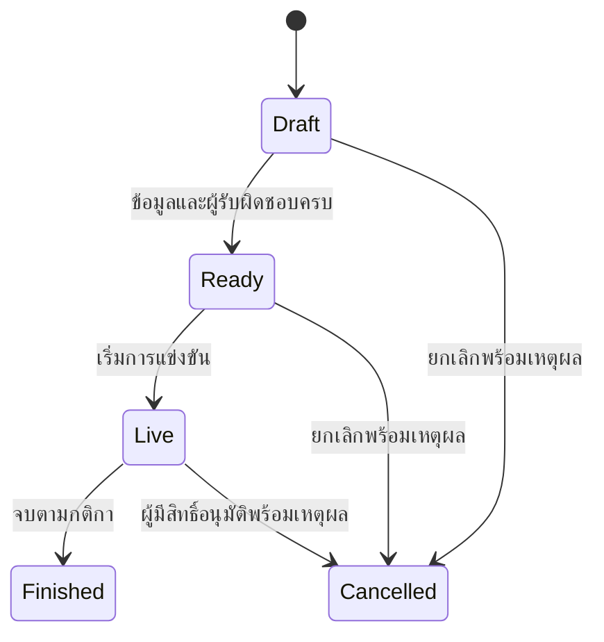
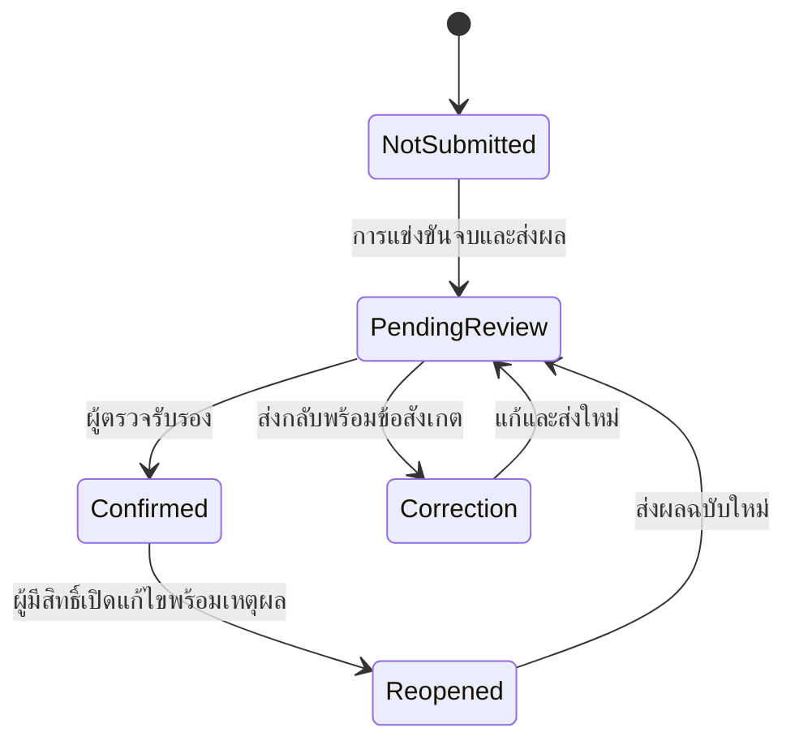
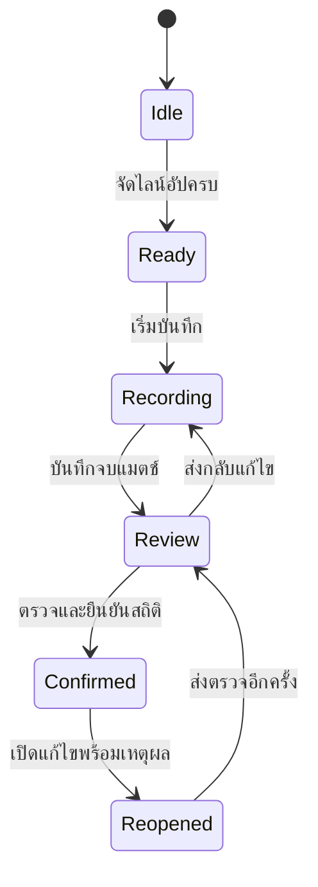

# แผนออกแบบส่วนผู้ดูแลระบบการแข่งขัน

สถานะ: ข้อเสนอสำหรับใช้เป็นแบบก่อนเริ่มพัฒนา ไม่ใช่ความสามารถที่ติดตั้งครบแล้ว

เอกสารนี้กำหนดผังเมนู รูปแบบหน้าจอ ตารางสิทธิ์ และสถานะงานร่วมกัน
การเปลี่ยนแปลงรอบนี้เป็นเอกสารเท่านั้น ไม่เปลี่ยนโค้ด สิทธิ์ หรือฐานข้อมูล

## ขอบเขตและข้อเท็จจริงของระบบปัจจุบัน

- เมนู Admin ปัจจุบันมีภาพรวม การแข่งขัน สโมสร/ทีม สนาม อันดับทีม นักกีฬา
  ผู้ฝึกสอน เจ้าหน้าที่ แมตช์ ระบบ VIS บัญชีผู้ใช้ และบัญชีรออนุมัติ
- หน้าจัดการผู้ฝึกสอนใน Admin ยังเป็น placeholder ต้องพัฒนาเป็นงานจริง
- Backend มีบทบาท `admin`, `organizer`, `scorer`, `referee`, `team_staff`
  และแปลง `score` กับ `statistician` เป็น `scorer` ในระบบ permissions
  การแยกผู้ตรวจสถิติออกจากผู้บันทึกจึงยังเป็นข้อเสนอ ไม่ใช่สิทธิ์ที่มีครบแล้ว
- `admin` ปัจจุบันได้รับ permission `*` ไม่ได้แยกผู้อนุมัติผลออกจากผู้แก้ไข
- หน้าระบบ VIS ใน Admin มีภาพรวม ตัวกรอง รายละเอียด และสรุปสถิติแล้ว
  แต่ข้อมูล Offline ที่ยังไม่ซิงค์จากเครื่องอื่นไม่สามารถนำมารวมได้
- ต้องรักษาการแยกคะแนนการแข่งขันทางการกับสถิติ VIS ระหว่างการพัฒนาต่อ

## 1. ผังเมนูที่เสนอ

| หมวด | เมนูภาษาไทย | เมนูภาษาอังกฤษ | เชื่อมกับส่วนเดิม / งานที่ต้องเพิ่ม |
|---|---|---|---|
| ภาพรวม | ศูนย์บริหารการแข่งขัน | Competition overview | พัฒนาจาก `home` |
| ภาพรวม | งานที่ต้องดำเนินการ | Action center | รวมงานค้างพร้อมลิงก์ไปหน้าที่เกี่ยวข้อง |
| การแข่งขัน | รายการแข่งขัน | Competitions | `competitions` |
| การแข่งขัน | ตารางและผลการแข่งขัน | Fixtures & results | `matches` |
| การแข่งขัน | สนามแข่งขัน | Venues | `stadium` |
| การแข่งขัน | อันดับการแข่งขัน | Standings | `team_ranking` |
| ทีมและบุคลากร | สโมสรและทีม | Clubs & teams | `clubs` |
| ทีมและบุคลากร | นักกีฬา | Players | `players` |
| ทีมและบุคลากร | ผู้ฝึกสอนและทีมงาน | Coaches & staff | พัฒนา `coaches` ให้ใช้งานจริง |
| ทีมและบุคลากร | ผู้ตัดสินและเจ้าหน้าที่ | Officials | `officials` |
| การบันทึก | ศูนย์ควบคุมคะแนน | Scoring control | เชื่อม ScorerControl ตามสิทธิ์ |
| การบันทึก | ศูนย์ข้อมูล VIMS | VIMS statistics | ใช้ tab key `escore` เดิมเพื่อรักษาการนำทาง |
| การบันทึก | ติดตามการซิงค์ | Sync monitoring | แสดงข้อมูลเซิร์ฟเวอร์และข้อจำกัด Offline |
| รายงาน | รายงานและเอกสาร | Reports & documents | รวม P-2 เอกสารคะแนน สถิติ และ CSV |
| ดูแลระบบ | บัญชีและการอนุมัติ | Accounts & approvals | เชื่อม `accounts`, `pending_users` |
| ดูแลระบบ | สิทธิ์และหน้าที่ | Permissions & assignments | เพิ่มหลังออกแบบสิทธิ์ Backend |
| ดูแลระบบ | ประวัติการดำเนินการ | Audit history | แสดงเฉพาะประวัติที่ระบบบันทึกจริง |
| ดูแลระบบ | ตั้งค่าระบบ | System settings | จำกัดค่าที่แก้ได้ตามหน้าที่ |

แนวทางการนำทาง:

1. แสดงเฉพาะหมวดที่บัญชีมีสิทธิ์ และตรวจสิทธิ์ซ้ำใน API ทุกครั้ง
2. แสดงตำแหน่งปัจจุบันและชื่อรายการแข่งขันเมื่ออยู่ในบริบทการแข่งขัน
3. จดจำตัวกรองและหน้าตารางเมื่อกลับจากรายละเอียด โดยไม่ปะปนข้ามบัญชี
4. ใช้ชื่อ VIMS เป็นชื่อระบบสถิติ และคง VIS ไว้กับชื่อรหัส/คำศัพท์ทางเทคนิค
5. ไม่สร้างเมนูที่กดแล้วไม่มีงานรองรับ เมนูใหม่เปิดใช้เมื่อพัฒนาครบเท่านั้น

## 2. รูปแบบหน้าจอมาตรฐาน

### โครงหน้า

```text
แถบด้านข้าง: หมวดเมนูและรายการที่กำลังเปิด
แถบบน: บริบทการแข่งขัน / ภาษา / บัญชีผู้ใช้
พื้นที่หลัก:
  ชื่อหน้า + คำอธิบาย                     ปุ่มดำเนินการหลัก
  สถานะข้อมูล / เวลาปรับปรุงล่าสุด
  ตัวกรองและค้นหา
  จำนวนผลลัพธ์ / สรุปที่เกี่ยวข้อง
  ตารางข้อมูลหรือรายละเอียด
  จำนวนต่อหน้า / เปลี่ยนหน้า
```

### สีและตัวอักษร

| องค์ประกอบ | โหมดสว่าง | โหมดมืด |
|---|---|---|
| พื้นหน้า | `#F8FAFC` | `#101927` |
| พื้นรายละเอียด | `#FFFFFF` | `#172435` |
| หัวส่วนและหัวตาราง | `#F1F5F9` | `#223247` |
| ข้อความหลัก | `#1E293B` | `#E5EDF7` |
| ข้อความรอง | `#526176` | `#ADBED3` |
| เส้นแบ่ง | `#D5DEEA` | `#40536B` |
| สีหลัก | `#0369A1` | `#7DD3FC` |

- ใช้ Sarabun ทั้งไทยและอังกฤษ: เนื้อหา 14px, ข้อความช่วย 12px,
  หัวส่วน 16–18px และชื่อหน้า 24px เป็นค่าเริ่มต้น
- เว้นระยะตามหน่วย 4px; ใช้ระยะระหว่างส่วน 16–24px
- ปุ่มหลักสูงอย่างน้อย 36px และขยายเป็น 44px ในบริบทที่ใช้การสัมผัส
- ตรวจ contrast ข้อความปกติอย่างน้อย 4.5:1 ในทั้งสองโหมด
- ใช้สีเขียวกับสำเร็จ/ยืนยัน เหลืองกับงานรอตรวจ และแดงกับข้อผิดพลาด/ยกเลิก
  ทุกสถานะต้องมีข้อความกำกับ ไม่สื่อความหมายด้วยสีเพียงอย่างเดียว

### ตารางและรายละเอียด

- กด “ดูข้อมูล” เพื่อเปิดรายละเอียดแบบอ่านอย่างเดียว; “แก้ไข” เป็นการกระทำแยก
- ชื่อทีมและรายการเป็นข้อมูลหลัก ส่วนรหัส/แหล่งข้อมูลเป็นข้อความรอง
- ชื่อยาวต้องอ่านได้ครบในรายละเอียด แม้ตารางจะแสดงแบบย่อ
- ตัวเลขคะแนนและเวลาใช้ตัวเลขความกว้างคงที่เพื่อเทียบแต่ละแถวได้ง่าย
- แสดงจำนวนผลลัพธ์หลังกรอง พร้อมปุ่มล้างตัวกรอง
- การเรียงข้อมูลต้องมีเครื่องหมายทิศทางและรองรับแป้นพิมพ์
- ส่งออกทั้งหมดตามตัวกรอง ไม่จำกัดเฉพาะหน้าตารางที่กำลังเห็น
- จอเล็กเลื่อนตารางแนวนอนได้ โดยปุ่มหลักและตัวกรองยังเข้าถึงได้

### กล่องโต้ตอบและฟอร์ม

- หัวกล่องระบุงาน เช่น “แก้ไขข้อมูลสนาม” ไม่ใช้ชื่อกว้าง ๆ ว่า “จัดการ”
- แสดงข้อผิดพลาดใกล้ช่องกรอก และเก็บค่าที่กรอกไว้เมื่อบันทึกไม่สำเร็จ
- ป้องกันการส่งซ้ำระหว่างบันทึก พร้อมแสดงสถานะกำลังทำงาน
- เมื่อปิดแล้วคืนโฟกัสไปปุ่มต้นทาง; ใช้ Tab ภายในกล่องและ Escape เพื่อปิด
- เตือนเมื่อออกจากฟอร์มที่แก้ไขค้างอยู่ โดยไม่ถามซ้ำกับฟอร์มที่ไม่มีการเปลี่ยนแปลง
- ยืนยันเฉพาะงานมีผลกระทบ เช่น ยกเลิกแมตช์หรือเปิดแก้ไขผลที่ยืนยันแล้ว

### สถานะหน้าจอที่ต้องออกแบบครบ

| สถานการณ์ | สิ่งที่ต้องแสดง |
|---|---|
| กำลังโหลด | ข้อความหรือ skeleton ที่คงโครงหน้า |
| ยังไม่มีข้อมูล | เหตุผลและปุ่มเพิ่มข้อมูลเมื่อมีสิทธิ์ |
| ค้นหาไม่พบ | ตัวกรองที่ใช้อยู่และปุ่มล้าง |
| โหลดล้มเหลว | ข้อผิดพลาดและปุ่มลองใหม่ ห้ามแสดงเป็นข้อมูลศูนย์เฉย ๆ |
| ใช้ข้อมูลเก่า | เวลาของข้อมูลและคำเตือนว่าอาจไม่เป็นปัจจุบัน |
| ไม่มีสิทธิ์ | คำอธิบายและทางกลับที่ใช้งานได้ |
| ข้อมูลถูกแก้จากอีกหน้าจอ | แจ้งความขัดแย้ง ให้โหลดใหม่ ไม่เขียนทับเงียบ ๆ |

## 3. ตารางสิทธิ์ที่เสนอ

ตารางนี้เป็น “หน้าที่” เป้าหมาย บัญชีหนึ่งได้รับได้หลายหน้าที่ และต้องจำกัด
ตามรายการแข่งขันที่ได้รับมอบหมาย ไม่จำเป็นต้องสร้าง role ถาวรเพิ่มทุกช่อง

สัญลักษณ์: ✓ ทำได้, มอบหมาย = เฉพาะขอบเขตที่ได้รับ, — ไม่ให้โดยค่าเริ่มต้น

| งาน | ผู้ดูแลระบบ | ผู้จัดการแข่งขัน | ผู้ตรวจรับผล | ผู้ตรวจสถิติ | ผู้บริหารอ่านอย่างเดียว |
|---|---|---|---|---|---|
| ดูภาพรวมและรายงาน | ✓ | มอบหมาย | มอบหมาย | มอบหมาย | มอบหมาย |
| จัดการบัญชีและสิทธิ์ | ✓ | — | — | — | — |
| จัดรายการ สนาม ตารางแข่ง | ✓ | มอบหมาย | — | — | — |
| จัดทีมและรายชื่อก่อนแข่ง | ✓ | มอบหมาย | ดู | ดู | ดู |
| ยืนยันผลทางการ | ✓ | — | มอบหมาย | — | — |
| ยืนยันสถิติ VIMS | ✓ | — | — | มอบหมาย | — |
| เปิดแก้ไขผลที่ยืนยันแล้ว | ✓ พร้อมเหตุผล | — | มอบหมายพร้อมเหตุผล | — | — |
| เปิดแก้ไขสถิติที่ยืนยันแล้ว | ✓ พร้อมเหตุผล | — | — | มอบหมายพร้อมเหตุผล | — |
| ส่งออกรายงาน | ✓ | มอบหมาย | มอบหมาย | มอบหมาย | มอบหมาย |
| ดูประวัติการดำเนินการ | ✓ | มอบหมาย | มอบหมาย | มอบหมาย | — |
| เปลี่ยนการตั้งค่าหลัก/การสำรอง | ✓ | — | — | — | — |

ข้อกำหนดก่อนนำไปใช้:

- ตรวจสิทธิ์ฝั่งเซิร์ฟเวอร์ทั้งการอ่าน การแก้ไข และการส่งออก
- แยกสิทธิ์ยืนยันผลออกจากสิทธิ์บันทึก; รายการสำคัญอาจกำหนดผู้ตรวจคนละบัญชี
- สิทธิ์ Admin แบบเต็มควรมีจำนวนจำกัด แต่ยังคงบัญชีผู้ดูแลสำหรับแก้เหตุฉุกเฉิน
- การปรับสิทธิ์ต้องบันทึกผู้ปรับ ค่าเดิม ค่าใหม่ และเวลา
- สำรวจการใช้ alias `statistician → scorer` ทุกเส้นทางก่อนแยกสิทธิ์
  เพื่อไม่ให้บัญชีเดิมเข้าใช้งานไม่ได้หรือได้สิทธิ์เกินเดิมโดยไม่ตั้งใจ
- เมนูและ API ต้องให้ผลตรงกัน รวมถึงการเปิดลิงก์ตรงและการเรียก API โดยตรง

## 4. ผังสถานะงาน

สถานะเป้าหมายด้านล่างต้องออกแบบการย้ายข้อมูลก่อนนำไปแทนสถานะปัจจุบัน
ไม่ควรเปลี่ยนชื่อ enum ในฐานข้อมูลทันที

### การแข่งขัน



ตรวจความพร้อมก่อน Ready: คู่แข่งขัน รุ่นอายุ/เพศ วันเวลา สนาม รายชื่อ
และเจ้าหน้าที่ตามข้อกำหนดของรายการ ตรวจการชนกันของเวลา/สนาม/ทีมด้วย

### การตรวจรับผลทางการ



### งานสถิติ VIMS



กติกาของข้อมูล:

1. “จบการแข่งขัน” ไม่เท่ากับ “ยืนยันผล” และไม่เท่ากับ “ยืนยันสถิติ”
2. ผลทางการใช้แหล่งคะแนนทางการ ส่วนสถิติใช้รายการ VIS ของแมตช์นั้น
3. ข้อมูล Offline เป็นสถานะการเข้าถึง/การซิงค์แยกต่างหาก ไม่ใช้แทนสถานะการแข่งขัน
4. ไม่แสดง “ยังไม่เริ่ม” พร้อมกับ “กำลังบันทึก” ในสถานะหลักเดียวกัน
5. บันทึกผู้ส่งตรวจ ผู้ยืนยัน เวลา เหตุผลการส่งกลับ และ revision ของข้อมูล
6. หลังเปิดแก้ไข ต้องทบทวนผลต่ออันดับและรายงานที่เคยเผยแพร่
   รายงานที่ส่งออกก่อนหน้านี้ต้องระบุ revision จึงตรวจย้อนหลังได้
7. ห้ามสรุปว่าข้อมูลครบจากการมีคะแนนอย่างเดียว ต้องตรวจรายชื่อและข้อมูลสถิติด้วย

## แผนดำเนินงานและเกณฑ์ตรวจรับ

| ระยะ | งานหลัก | เกณฑ์ตรวจรับ |
|---|---|---|
| 1 | มาตรฐาน UI และเมนู | เลือกหน้าตัวอย่าง 3 หน้า: ภาพรวม ตาราง และรายละเอียด; ใช้สองภาษา/สองธีมได้ครบ |
| 2 | สถานะและตรวจความพร้อม | ทดสอบตั้งแต่สร้างรายการจนจบแมตช์ รวมกรณีเลื่อน/ยกเลิกและข้อมูลไม่ครบ |
| 3 | สิทธิ์และประวัติ | ทดสอบทุกหน้าที่ผ่าน UI และ API; บันทึกการเปลี่ยนผลและสิทธิ์ย้อนตรวจได้ |
| 4 | งานค้างและรายงาน | จำนวนสรุป ตาราง และไฟล์ส่งออกตรงกันตามตัวกรองและ revision |
| 5 | ความพร้อมใช้งาน | ทดสอบหลายผู้ใช้ ข้อมูลขัดแย้ง Offline/ซิงค์ สำรองและกู้คืนข้อมูล |

ก่อนขึ้นระบบจริงต้องมีข้อมูลทดสอบที่ไม่ใช่ข้อมูลแข่งขันจริง แผนย้ายสถานะ/สิทธิ์
และแผนย้อนกลับที่ทดสอบแล้ว การกู้คืนต้องตรวจทั้งฐานข้อมูล ไฟล์รายงาน/เอกสาร
และความสัมพันธ์ของแมตช์ ทีม รายชื่อ และประวัติ ไม่ตรวจเพียงว่าไฟล์สำรองเปิดได้

## ขอบเขตงานพัฒนารอบแรกที่แนะนำ

เริ่มจากปรับโครง AdminDashboard และมาตรฐานตาราง/รายละเอียด โดยคง tab key,
API และสิทธิ์เดิมไว้ก่อน ใช้หน้า “ภาพรวม”, “ตารางและผลการแข่งขัน” และ
“ศูนย์ข้อมูล VIMS” เป็นหน้าต้นแบบ จากนั้นจึงขยายรูปแบบไปหน้าทีม บุคลากร
และบัญชีผู้ใช้ การเพิ่มสิทธิ์และสถานะใหม่เป็นงานถัดไปที่ต้องมีการย้ายข้อมูลรองรับ

## เอกสารและโค้ดที่ใช้ตรวจสภาพปัจจุบัน

- `client/src/pages/admin/AdminDashboard.jsx`
- `backend/config/permissions.js`
- `docs/technical/admin-vims.md`
